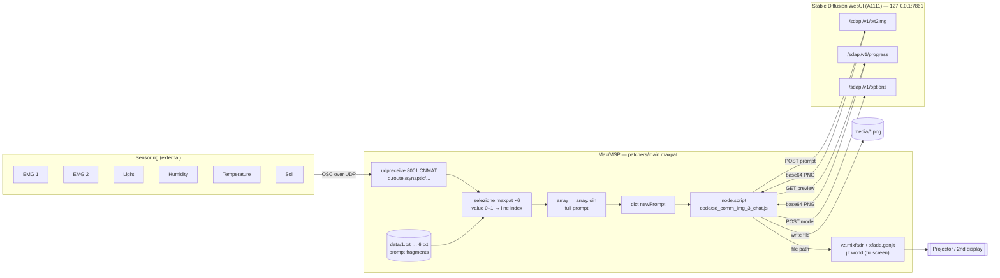
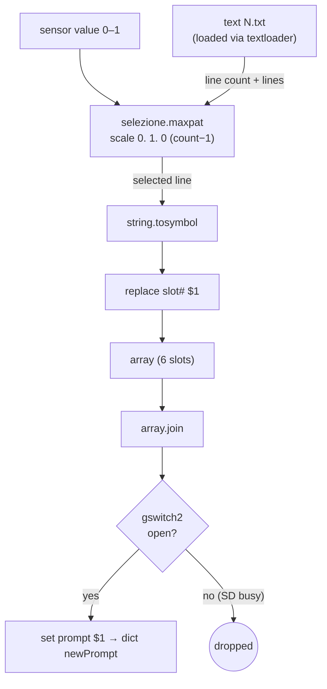
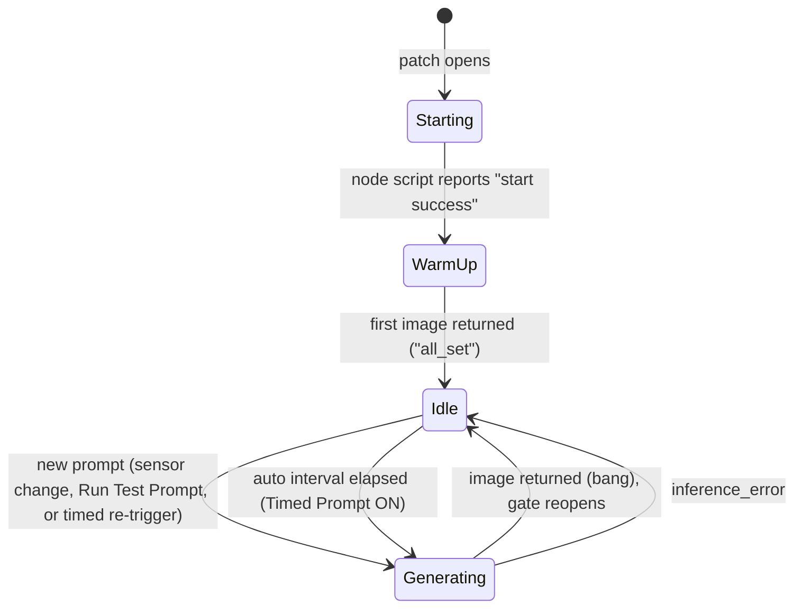
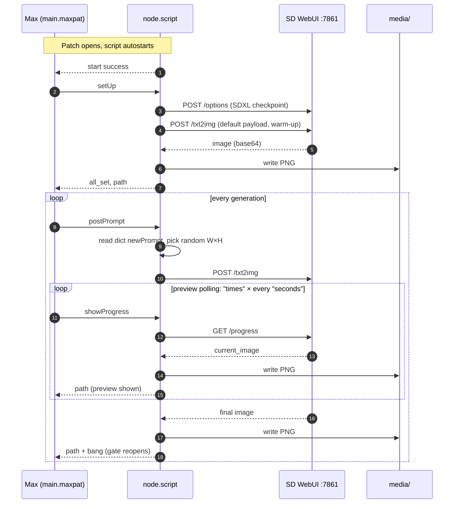
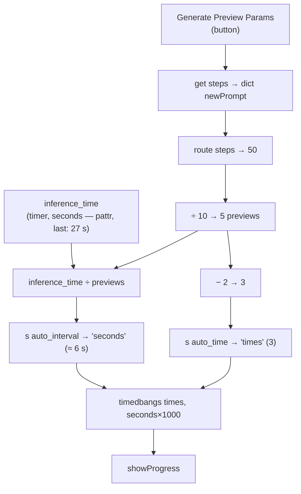

# synaptic

Max/MSP system for **_Synaptic Dialogues_**, an artwork by **Emidio Battipaglia**.

Live sensor data (two EMG channels plus light, humidity, temperature and soil readings) steers the text prompt of a Stable Diffusion XL model. The generated images, together with their in-progress previews, are cross-faded on a projector. Every image shows a server room inside a rainforest. The sensors decide its condition: how alive the vegetation is, how much water there is, the sky, the atmosphere, the time of day and how much infrastructure has taken over.

- **Technical documentation:** this file
- **Reinstallation guide** (step-by-step, for whoever sets up the installation): [`docs/reinstallation-guide.md`](docs/reinstallation-guide.md)

Built in May 2024 on Windows with Max 8.6.2 and the AUTOMATIC1111 Stable Diffusion WebUI.

---

## Contents

1. [System overview](#1-system-overview)
2. [Repository layout](#2-repository-layout)
3. [From sensors to prompt](#3-from-sensors-to-prompt)
4. [When a new image is requested](#4-when-a-new-image-is-requested)
5. [Talking to Stable Diffusion](#5-talking-to-stable-diffusion)
6. [Live previews and their calibration](#6-live-previews-and-their-calibration)
7. [Display](#7-display)
8. [Parameters reference](#8-parameters-reference)
9. [Dependencies and environment](#9-dependencies-and-environment)
10. [Known issues and design notes](#10-known-issues-and-design-notes)

---

## 1. System overview

Max handles the logic: OSC input, prompt composition, timing, state and display. A small Node for Max script handles the HTTP side. Stable Diffusion runs as a separate local server.

## 2. Repository layout

| Path | What it is |
| --- | --- |
| `synaptic.maxproj` | Max project file. Open this to run the system. |
| `patchers/main.maxpat` | Top-level patch: OSC input, prompt builder, timers, status UI, display |
| `patchers/selezione.maxpat` | Maps a 0–1 value to a line of a text file (used 6×) |
| `patchers/textloader.maxpat` | Loads a `data/N.txt` file into a `text` object |
| `patchers/timedbangs.maxpat` | Sends *N* bangs every *M* ms (drives preview polling) |
| `patchers/vz.mixfadr.maxpat` | Vizzie-derived crossfader between consecutive images |
| `patchers/video-handler.maxpat`, `data-handler.maxpat`, `exact_menu.maxpat`, `vzgl-*.maxpat` | Vizzie internals used by `vz.mixfadr` |
| `patchers/n4m.monitor.maxpat` | Node for Max console/monitor (shows script status) |
| `patchers/shell/` | `shell` external (Win + Mac builds), used to open folders in Explorer |
| `code/sd_comm_img_3_chat.js` | **Active** Node script: talks to the SD WebUI API |
| `code/xfade.genjit` | Crossfade shader (Gen) |
| `code/vizzie-*.js`, `code/fit_jweb_to_bounds.js`, `code/resize_n4m_monitor_patcher.js` | Support scripts for Vizzie modules and the N4M monitor |
| `data/1.txt` … `data/6.txt` | Prompt fragments, one per sensor (see §3) |
| `data/settings.json` | `pattrstorage` snapshot of the UI parameters (see §8) |
| `data/package.json` | Leftover npm manifest from the first script version; not needed at runtime |
| `externals/o.route.mxe64` | CNMAT odot `o.route` (Windows build only, see §10) |
| `media/` | Generated images and previews end up here (git-ignored) |
| `avvio.bat` | Windows launcher for the SD WebUI (*avvio* = "startup") |
| `_archive/` | Superseded versions, kept for reference (see below) |
| `docs/` | The reinstallation guide |

Each subfolder has a short `README.md` describing its files.

### `_archive/`

| Path | Notes |
| --- | --- |
| `_archive/code/sd_comm.js` | First version: POST prompt → save image |
| `_archive/code/sd_comm_img.js` | Second version |
| `_archive/code/sd_comm_img_2.js` | Third version (was in Max's `_DeletedItems`) |
| `_archive/scripts/avvio_old*.bat` | Earlier launchers. One also started `synaptic.maxproj` after the WebUI. |
| `_archive/touchdesigner/SynapticTD.1.toe` | An abandoned TouchDesigner prototype of the same system |

None of these files are referenced by the Max project.

## 3. From sensors to prompt

### OSC routing

`udpreceive 8001 CNMAT` receives OSC bundles and `o.route` splits them by address. Each value goes through a slider, which also gives visual feedback, then into its own `selezione` instance. **Values are expected to be already normalised to 0–1**, since the sliders have `size 1.0` and float output.

| OSC address | Fragment file | Prompt slot | Semantic axis |
| --- | --- | --- | --- |
| `/synaptic/emg2` | `data/1.txt` | 0 | State of vegetation |
| `/synaptic/soil` | `data/2.txt` | 1 | Land and water |
| `/synaptic/temperature` | `data/3.txt` | 2 | Sky |
| `/synaptic/humidity` | `data/4.txt` | 3 | Atmosphere and light quality |
| `/synaptic/light` | `data/5.txt` | 4 | Time of day |
| `/synaptic/emg1` | `data/6.txt` | 5 | Technological presence (+ LoRA tags) |

### Fragment files

Each file holds 5 lines, ordered from the lowest to the highest sensor value:

| File | Line 1 (≈0.0) | → | Line 5 (≈1.0) |
| --- | --- | --- | --- |
| `1.txt` | server room inside rainforest, bare branches, no leaves | healthy leaves → open flowers → dry leaves | broken and wilted branches |
| `2.txt` | desert land | dry arid land → rivers, waters → abundant rivers | swamp pools, water |
| `3.txt` | rain, stormy clouds | stormy clouds → cloudy sky → clear sky | clear sky, sunny |
| `4.txt` | sharp shadows | saturated colors → clear view → hazy light fog | steamy dense fog |
| `5.txt` | at dusk | at sunshine → at twilight → late morning | at noon |
| `6.txt` | server racks | + datacenter → + cables → + data storage | + industrial battery storage |

Every line of `6.txt` ends with the two custom LoRA tags `<lora:Rainforest-000006:1><lora:Server_Room-000003:1>`. Every line of `1.txt` starts with the fixed subject *"server room inside rainforest"*. Together the six files define a closed space of 5⁶ = 15,625 possible prompts, all of them written by hand.

### Composition

`selezione` rescales the 0–1 value to an integer between 0 and *lines − 1* and outputs that line. The six slots live in an `array`. Every time a slot changes, the array is joined into a single prompt string.

You can edit the fragment files freely, but keep each line ending with a comma and a space so the joined prompt still reads correctly. A file may have more or fewer than 5 lines, because `selezione` reads the line count at load time.

## 4. When a new image is requested

Generation is **gated**: a new prompt is accepted only after the previous inference has finished. Sensor changes that arrive while SD is busy are dropped, not queued.

### Why there is no queue

Sensors stream continuously, many messages per second, while one SDXL image takes tens of seconds. If every change were queued:

- **The backlog would grow without limit.** Thousands of prompts would pile up behind the GPU, and the installation would fall further and further behind.
- **The image would describe the past.** What reaches the projector would reflect the sensor state from minutes earlier, which breaks the sense of a live dialogue between the bodies, the environment and the image.
- **Pacing would depend on the GPU.** A slower machine would only build a longer queue.

Gating gives *latest-value-wins* semantics instead. When SD becomes free, the next incoming sensor change carries the current state of all six axes, because the `array` always holds the most recent value of every slot. Nothing is lost that matters: intermediate states are simply never rendered. On a slower GPU the images change less often, but each one still reflects the present.

The gate is a `gswitch2` placed between `array.join` and `set prompt`:

- it **closes** (`t b 0 0`) as soon as a prompt is sent;
- it **reopens** (`t b 1 b`) when the script reports the finished image (`bang`).

A new prompt can come from three sources:

1. **Sensors.** With the gate open, the next change in any slot sends the newly joined prompt.
2. **Run Test Prompt button.** Re-sends the prompt currently stored in the `dict`.
3. **Timed Prompt.** When the toggle is on, a `delay` re-sends the current prompt *N* ms after the last image completed. *N* comes from the Minutes/Seconds UI, default 90 s (`auto_interval` in `settings.json`). This keeps the installation evolving when the sensor values are steady.

Each request also starts a `timer`. Its result (`inference_time`) is used to calibrate the previews (§6).

## 5. Talking to Stable Diffusion

`code/sd_comm_img_3_chat.js` runs inside `node.script … @autostart 1 @watch 1`. It exposes three handlers:

| Max message | Handler | HTTP call | Outlet messages |
| --- | --- | --- | --- |
| `setUp` | Loads the model, then makes a warm-up generation | `POST /sdapi/v1/options`, then `POST /sdapi/v1/txt2img` | `all_set` + file path, or `setup_error` / `not_ready_yet` |
| `postPrompt` | Reads `prompt` from `dict newPrompt`, picks a random format, generates | `POST /sdapi/v1/txt2img` | file path + `bang`, or `inference_error` / `not_ready_yet` |
| `showProgress` | Fetches the current intermediate image | `GET /sdapi/v1/progress?skip_current_image=false` | file path, or `not_ready_yet` |

Every image, final or preview, is decoded from base64 and written to `media/<timestamp>.png`. Its absolute path is then sent to Max, which loads it into the video chain.

### Inference parameters (hard-coded in the script)

| Parameter | Value | Line |
| --- | --- | --- |
| Checkpoint | `sd_xl_base_1.0.safetensors [31e35c80fc]` | 39 |
| `show_progress_every_n_steps` | 2 | 40 |
| `negative_prompt` | long quality/artefact list | 46 |
| `cfg_scale` | 13 | 48 |
| **`steps`** | **20** | **49** |
| Formats (random per image) | 1152×768, 768×1152, 1366×768 | 178–179 |
| Sampler | not set, so the WebUI default applies | — |
| Server | `127.0.0.1:7861` | 10, 20, 27 |

**The step count is set only here.** It is not read from Max, and `webui-user.bat` has no effect on it, because a value in the API payload always overrides the WebUI defaults. To change it, edit line 49 and save. Thanks to `@watch 1`, the script restarts automatically. See [issue #1](https://github.com/AhUhmm/synaptic/issues/1).

## 6. Live previews and their calibration

Max does not know which step SD has reached. Previews are fetched **on a timed schedule**: after `postPrompt`, `timedbangs` sends `showProgress` *times* times, once every *seconds*. That schedule is derived from a measured inference time.

> ⚠️ **`steps` in the Max `dict` is not the inference step count.** The embedded `dict newPrompt` contains `"steps": 50`. Max uses it only as a divisor to decide how many previews to request (50 ÷ 10 = 5, of which 3 are actually polled). The real inference runs with the 20 steps set in the script. The two values were never linked.

**To recalibrate after changing hardware or steps:** run one generation (Run Test Prompt), wait for it to finish, then press **Generate Preview Params**. The new `seconds` and `times` values are stored through `pattrstorage settings` (`data/settings.json`).

## 7. Display

- `jit.world screen @erase_color 0 0 0 1 @fsmenubar 0 @border 0 @output_texture 1` renders the output.
- The **Fullscreen** controls move the window to the second display (top-left coordinates of the 2nd monitor) and switch it to fullscreen.
- New images are blended by `vz.mixfadr` (a Vizzie-derived module using `xfade.genjit`). Crossfade speed presets are *Slow / Normal / Instant / Custom* (`fadr_speed`, `custom_speed`).
- `loadmess countdown.mov` loads a placeholder video at startup. The file is not in the repo.

## 8. Parameters reference

### Persisted in `data/settings.json` (`pattrstorage settings @savemode 3`)

| Key | Value | Meaning |
| --- | --- | --- |
| `seconds` | 6 | Interval between preview polls (s) |
| `times` | 3 | Number of preview polls per generation |
| `u953010366` | 27 | Last measured inference time (s); unnamed `pattr` |
| `osc_port` | 8001 | OSC input port |
| `auto_interval` | 90 | Timed Prompt interval (s) |
| `fadr_speed` | 3 | Crossfade speed preset |
| `custom_speed` | 2.0 | Crossfade speed when preset = Custom |
| `mixfadr::operator`, `mixfadr::xfade-value` | 13.0, 0.0 | Crossfader internal state |

### Hard-coded elsewhere

| Where | What |
| --- | --- |
| `code/sd_comm_img_3_chat.js` | All inference parameters (§5), API host and port |
| `patchers/main.maxpat` → `dict newPrompt @embed 1` | Last prompt + `steps` divisor for previews |
| `avvio.bat` | Absolute path to the WebUI install on the original PC |

## 9. Dependencies and environment

| Component | Version / note |
| --- | --- |
| OS | Windows 10/11 (the `shell` and `o.route` builds in the repo are `.mxe64`) |
| Max | 8.6.2, with Node for Max (bundled) |
| CNMAT `o.route` | Windows build in `externals/`. `udpreceive 8001 CNMAT` is a built-in Max object. |
| Stable Diffusion WebUI | [AUTOMATIC1111](https://github.com/AUTOMATIC1111/stable-diffusion-webui), installed **outside** this project, in a short path without spaces, e.g. `C:\sd\stable-diffusion-webui`. Launched with **`--api`** and **`--port 7861`** in `webui-user.bat` (`COMMANDLINE_ARGS`). |
| Checkpoint | `sd_xl_base_1.0.safetensors` in `models/Stable-diffusion/` ([Hugging Face](https://huggingface.co/stabilityai/stable-diffusion-xl-base-1.0)) |
| LoRA | `Rainforest-000006.safetensors`, `Server_Room-000003.safetensors` in `models/Lora/`. Custom-trained and **owned by the artist**. They are deliberately kept out of this repo and must be obtained from the artist. Never commit them. |
| CNMAT odot | Package providing `o.route` (OSC routing, **required**) and `o.display` (OSC monitor, optional). Install it from the Max Package Manager. |
| GPU | NVIDIA. The original machine handled SDXL at about 1 MP, 20 steps, in about 27 s per image including overhead. |

`webui-user.bat` lives in the WebUI folder, not in this repo. Its exact flags on the original machine were not saved. `--api` is required, and port 7861 (the default is 7860) is what the script expects.

## 10. Known issues and design notes

- **Inference parameters can't be changed from Max.** Steps, CFG and formats are hard-coded in JS, and the `steps` key in the Max `dict` is only a preview divisor. Tracked in [issue #1](https://github.com/AhUhmm/synaptic/issues/1): read them from the `dict` so a single value drives both inference and preview timing.
- **The warm-up image is a deliberate check.** `setUp` generates with the script's default prompt (`"maltese puppy"`) and sends the result to the display. An image that is obviously unrelated to the work is visual confirmation that the whole round trip Max → SD → Max works. It is safe to show on the projector.
- **`media/` is an archive, not a cache.** Every final image *and* every preview is kept as a PNG. Images may be reused for promotional purposes, so the folder is cleared only when disk space runs short, after copying its content elsewhere.
- **odot externals are incomplete.** Only the Windows build of `o.route` is bundled, and `o.display` is missing entirely. Without the odot package, the OSC monitor box shows up disabled, and on macOS `o.route` is missing too. Tracked in [issue #2](https://github.com/AhUhmm/synaptic/issues/2).
- **No single-click launcher.** An earlier launcher (`_archive/scripts/avvio_old2.bat`) started both the WebUI and the Max project, but it was dropped. Tracked in [issue #3](https://github.com/AhUhmm/synaptic/issues/3).
- **Absolute paths.** `avvio.bat` and the "open data folder" `shell` message point to paths on the original PC (`C:\Users\feder\...`).
- **The checkpoint is pinned by hash.** If the checkpoint file differs, update line 39. The exact name is listed at `http://127.0.0.1:7861/docs` → `GET /sdapi/v1/sd-models`.
- **The three request functions are near duplicates** in the script (`SendPrompt`, `setUpPrompt`, `updateRequest`). Candidate for refactoring.
- **`cfg_scale` 13 is high for SDXL**, which typically uses 5–8. This was probably chosen to push the LoRA style. Lowering it changes the look, not the speed.
